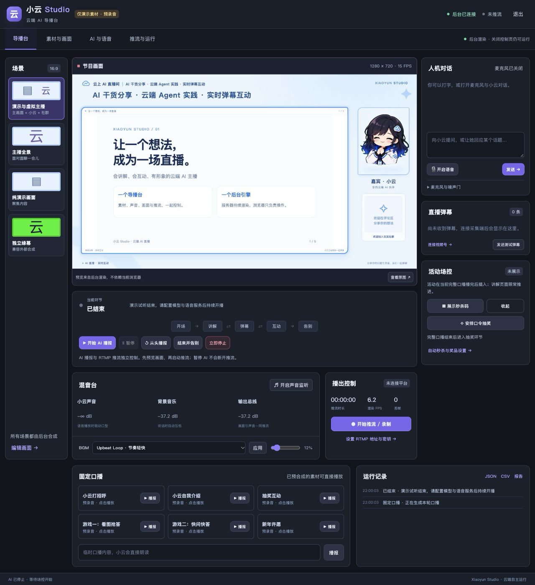
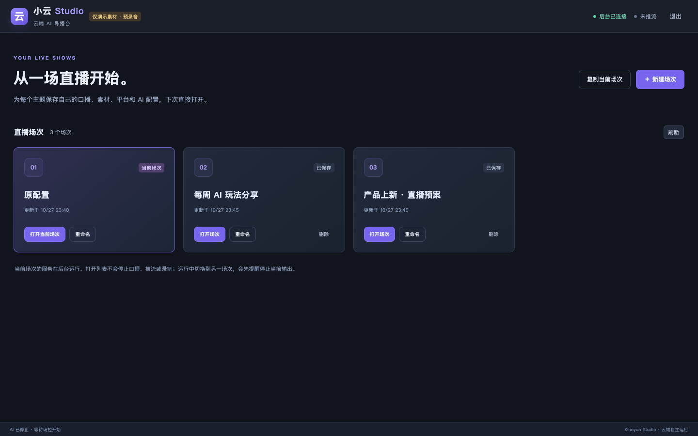
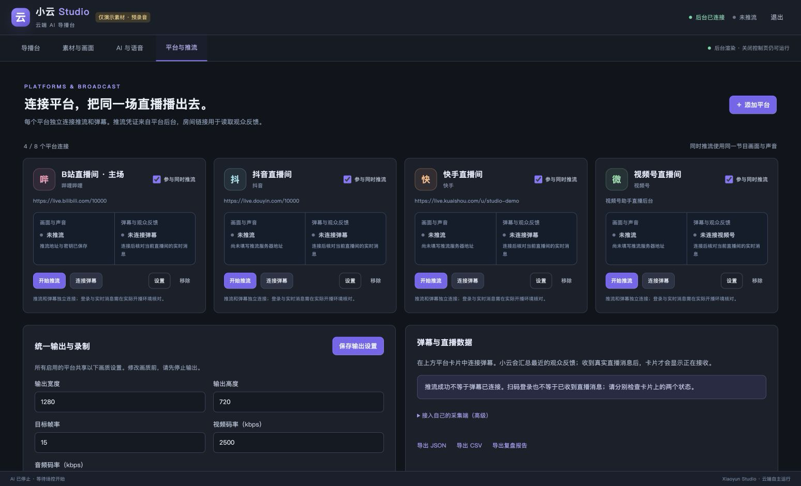
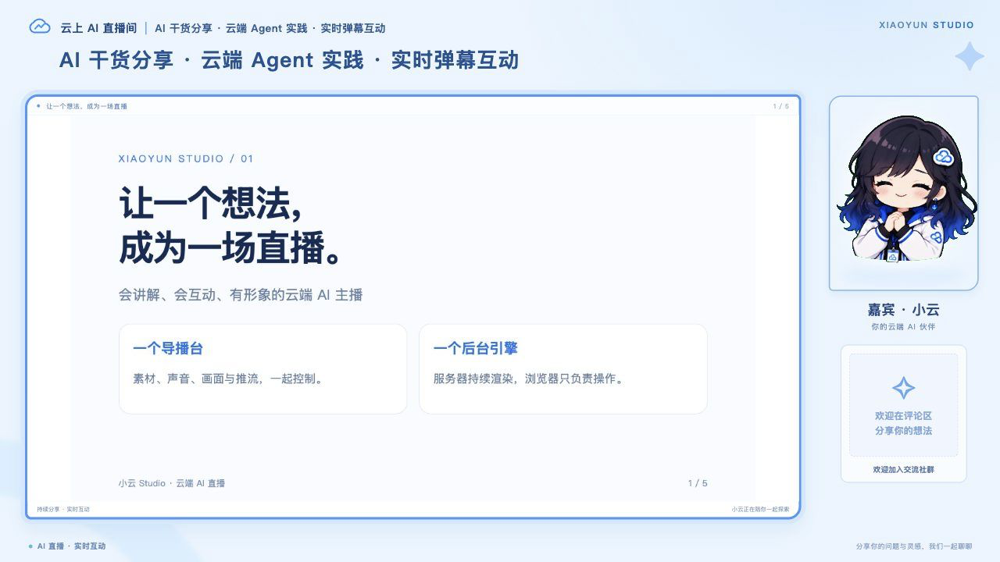

# 小云 Studio

**一个网页导播台，把 AI 主播、演示稿、弹幕、音频混音和 RTMP 推流放到同一套独立服务里。**

部署到 Linux 后，由服务器上的无界面 Chromium 渲染画面，FFmpeg 编码、录制并推流。电脑上的网页用于控制和监听；关闭控制网页不影响已启动的后台推流。运行时不依赖 DSH、Cordis、OBS 或桌面窗口采集。



## 已有能力

| 能力 | 使用方式 |
| --- | --- |
| 一体化导播 | 预览合成画面，切换标准、人物、演示稿和绿幕布局；配置标题、字幕、人物与社群二维码 |
| 直播场次 | 新建、复制、改名和切换；提示词、演示稿、固定口播、声音、平台连接及运行资料按场保存 |
| 多平台推流与录像 | ＋ 添加平台，分别设置 RTMP/RTMPS 地址和密钥；同一画面同时输出，单路启停/重试，录制独立 |
| AI 主讲与人机互聊 | 系统身份、开场、结束语、当前页讲解、多轮展开；文字提问；可选麦克风、闭麦和语音打断 |
| HTML / PDF 演示 | 上传或打开网页演示稿；提取当前页文字，AI 决定何时翻页；讲完可循环，保留抽奖历史 |
| 口播与声音 | 预录音一键播报；腾讯云或兼容接口合成；播放时准备后续文本/语音；完整口播之间穿插弹幕 |
| BGM 与监听 | 四首附来源的 CC0 音乐；音量、说话时压低伴奏；网页耳机监听后台混音 |
| 四平台弹幕 | 哔哩哔哩、抖音、快手、视频号独立后台登录与采集，弹幕保留来源；可接外部弹幕桥 |
| 秒杀与抽奖 | 定时秒杀二维码，1–30 分钟后自动隐藏，展示期间继续翻页；口令抽奖支持手动、间隔、固定时间和人气触发 |
| 长播与多端控制 | 一个服务维护统一状态；有界上下文、最近两分钟最多 100 条弹幕、两分钟无声恢复；多台电脑同步操作 |
| 数据导出 | 导出 JSON / CSV / Markdown 报告，保留采样时间与字段来源，区分观看人数、观看次数等指标 |







这是可运行的第一版。实际无界面渲染、声音、录像、回环 RTMP 与 PDF 翻页有自动验证；第三方直播平台接收、真实视频号账号会话和 24/48 小时稳定性需要在目标环境验收。详见 [验证记录与边界](docs/validation.md)。

## 用 Docker 启动

需要一台安装了 Docker Compose 的 Linux 主机。

```sh
git clone https://github.com/sliverp/xiaoyun-studio.git
cd xiaoyun-studio
cp .env.example .env
# 编辑 .env：STUDIO_ADMIN_PASSWORD 填至少 12 个字符的独立管理员密码
# 保留其他设置即可先体验预录口播与录像

docker compose up -d --build
```

访问 `http://服务器地址:18080`，使用设置的密码登录。首次使用：

1. 登录后进入「直播场次」，新建一场空白直播，或打开「原配置」体验内置演示。在「素材与主播」设置演示稿、系统提示词和开场/结束语，保存到当前场次。
2. 在「模型与声音」填写自己的模型与语音服务；**内置演示模式只播放明确标注的固定录音**，不会把任意文案伪装成合成结果。
3. 在「平台与推流」点「＋ 添加平台」，分别填写推流地址、密钥和直播间；需要时扫码登录。没有目的地时可仅录像。
4. 点「开始输出」启动后台编码，再点「开始 AI 讲解」，或先点击一条固定口播试听。无需另外开启 OBS。
5. 点击口播、提问或开始 AI 讲解时，网页会先接通本机声音；也可以在混音台手动开关监听。「本机静音」只影响当前浏览器，服务器的推流和录制仍有声音。在另一台设备打开同一地址即可看统一场次和运行状态。

公网使用应配置 HTTPS 和访问控制。麦克风需要 HTTPS 或 localhost 安全环境。配置、登录凭据、上传素材、录音和报告都保存在持久卷；`docker compose down` 不删除它们。`down -v` 会删除数据，勿用于升级。详见 [部署与操作](docs/deployment.md)。

## 本地开发

需要 Node.js 24、Chrome/Chromium；`npm ci` 会安装所需依赖和 FFmpeg 静态工具。Linux 镜像使用系统 FFmpeg。

```sh
npm ci
npm start
```

默认仅监听 `127.0.0.1:18080`。未提供管理员密码时，程序随机生成密码并将位置提示为 `.data/first-login.txt`，不会在日志中打印密码。可通过 `CHROMIUM_PATH` / `FFMPEG_PATH` 指定工具位置。

```sh
npm run check
npm test
npm run test:media
```

## 导入旧项目素材

导入是复制操作，不修改旧目录、不连接旧服务。密钥、浏览器会话、观众记录和旧服务运行状态不会被复制。

```sh
npm run migrate -- --source /path/to/previous-project
# 确认导入结果后，可显式加 --apply 将新服务切换为导入的演示稿、话术与录音
```

[按直播场次保存](docs/projects.md) · [多平台接入与开源调研](docs/platforms.md) · [迁移说明](docs/migration.md) · [架构与状态](docs/architecture.md) · [接口和演示稿协议](docs/api.md) · [安全与数据](docs/security.md) · [素材来源](THIRD-PARTY.md)

## 许可

MIT。保留既有公开代码与素材的版权说明；BGM 来源与 CC0 许可见各文件说明。自己的直播素材、品牌和第三方语音服务使用权需由部署者确认。项目不会附带运营者的生产密钥、私有直播材料或平台登录状态。
