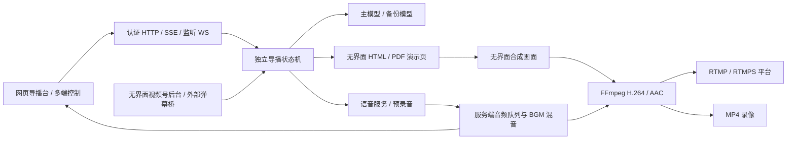
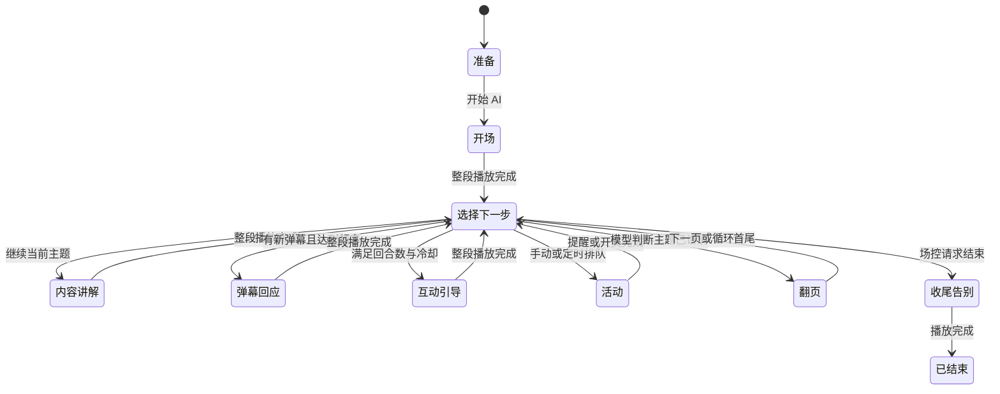

# 架构与状态

服务直接调用模型、TTS 与 ASR，不创建 DSH 会话。HTTP 服务拥有唯一导播实例和媒体实例；控制浏览器只发送操作、接收状态与耳机监听数据。

## 调度顺序

开场欢迎后进入内容讲解。每次完整口播完成，状态机重新选择下一步：已排队的活动、明确的主持人提问、新弹幕、适量互动、继续当前主题或翻页。抽奖拥有说明、参与窗口和结果三个子步骤。秒杀二维码的倒计时与讲解分开，因此无需停在某张活动页。

网页显示当前阶段、原因、当前口播、后续准备、活动队列和转移历史。语音片段合成完成不代表播报完成：状态推进以音频混音器真实消费完该片段为准。下一段准备可与当前播放重叠；当场控暂停、打断、更换素材或结束时，旧的预生成结果会取消。

一页可有很多轮讲解。模型每轮返回 speech、navigation 和可选 interaction；只有 navigation=next 才正常推进。补充笔记可按页组织，旧页摘要会在换页时释放；身份和系统提示词始终在每轮请求中重建。模型输入有总字节上限，弹幕有时间和数量上限。没有长驻模型会话需要“释放”，只维护当前页的有界内存和请求取消信号。

## 媒体进程

MediaEngine 创建自己的 Chromium 用户目录。演示页和合成页分开，合成页读取演示页截图与安全节目状态。JPEG 帧经管道进入 FFmpeg；服务端把语音/BGM 解码并混合成连续 48kHz 双声道 PCM，再交给同一编码器。音频监听复制混音流，不决定输出时钟。

Chromium 意外退出时尝试恢复该实例及当前页；推流失败有有界重连。AI 两分钟没有实际语音能量且仍希望运行时会尝试恢复原流程，尊重暂停与主动停止。服务进程或主机完全退出后不自动向外开播，需要管理员确认。

## 数据归属

配置、私密密钥、浏览器登录目录、导播历史、音频缓存、素材和录像均属于该部署的数据目录。奖品结果和活动去重记录持久化；讲解缓存、未读弹幕和运行中的请求为当前进程所有。报告导出来自当前进程的有界采样，缺失指标保持缺失，带来源与采样时间。原始事件写入私有日志，但重启后报告暂不从日志重建旧指标切面；需要在重启前导出报告。多控制端访问同一状态，无任何控制端夺取“声音播报权”的操作。
