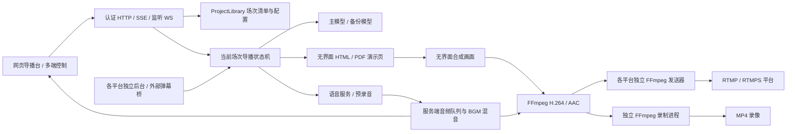
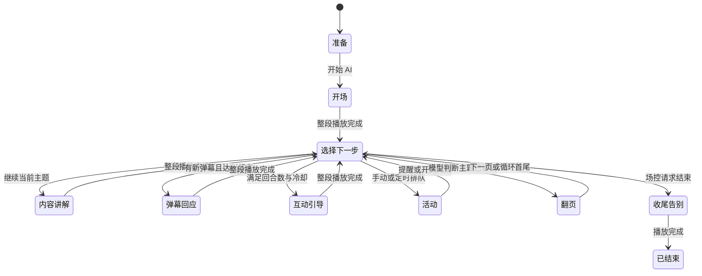

# 架构与状态

服务直接调用模型、TTS 与 ASR，不创建 DSH 会话。同一服务可保存多个直播场次，但一次只运行一个活动场次；所有控制浏览器操作同一场次，接收共享状态和各自的本机监听音频。

## 场次与运行实例

ProjectLibrary 管理场次清单、当前场次 ID 和各场配置目录。HTTP 服务共享管理员认证、上传素材库与状态订阅，并为当前场次创建独立的导播、模型调用、媒体和平台采集实例。未打开的场次只保留文件，不占用运行中的浏览器或推流进程。

切换前检查当前讲解、输出及未完成操作；正在运行时需操作者明确确认停止。切换会取消旧任务、关闭旧场的音频、编码器与采集浏览器，再建立目标场次的运行实例，保持未开播状态。切换期间拒绝新的场次操作，网页携带场次 ID，避免延迟请求写入另一场。目标初始化失败时会尝试清理新建资源并恢复原场实例，恢复后也保持停止；清理或恢复仍失败时返回错误，需要管理员处理。操作流程见[按直播场次保存](projects.md)，接口与冲突响应见[场次接口](api.md#直播场次)。

## 调度顺序

开场欢迎后进入内容讲解。每次完整口播完成，状态机重新选择下一步：已排队的活动、明确的主持人提问、新弹幕、适量互动、继续当前主题或翻页。抽奖拥有说明、参与窗口和结果三个子步骤。秒杀二维码的倒计时与讲解分开，因此无需停在某张活动页。

网页显示当前阶段、原因、当前口播、后续准备、活动队列和转移历史。语音片段合成完成不代表播报完成：状态推进以音频混音器真实消费完该片段为准。下一段准备可与当前播放重叠；当场控暂停、打断、更换素材或结束时，旧的预生成结果会取消。

一页可有很多轮讲解。模型每轮返回 speech、navigation 和可选 interaction；只有 navigation=next 才正常推进。补充笔记可按页组织，旧页摘要会在换页时释放；身份和系统提示词始终在每轮请求中重建。模型输入有总字节上限，弹幕有时间和数量上限。没有长驻模型会话需要“释放”，只维护当前页的有界内存和请求取消信号。

## 媒体进程

每个活动场次的 MediaEngine 使用自己的 Chromium 用户目录。演示页和合成页分开，合成页读取演示页截图与安全节目状态。JPEG 帧经管道进入 FFmpeg；服务端把语音/BGM 解码并混合成连续 48kHz 双声道 PCM，再交给同一 H.264/AAC 编码器。

共享编码结果通过有界缓冲送给各平台独立的发送进程，以及独立的 MP4 录制进程；发送和录制使用已有编码包，不重复编码。单个平台可单独停止或重试，失败不会阻塞其他发送器和录制。输出引擎仍在运行与某一路已经有实际发送进度是不同状态，本地录像成功也不等于第三方平台收到直播。字段含义见[平台接口](api.md#平台连接)，配置方式见[多平台接入](platforms.md)。

本机监听从混音流复制音频，只有通过认证且已接通的控制浏览器才接收。首次点击口播、提问或开始讲解时，网页先等待音频握手和浏览器播放权限；显式本机静音偏好保存在该浏览器，不影响服务器的语音、推流或录制。关闭控制网页不会改变服务器输出时钟。

Chromium 意外退出时尝试恢复该实例及当前页；推流失败有有界重连。AI 两分钟没有实际语音能量且仍希望运行时会尝试恢复原流程，尊重暂停与主动停止。服务进程或主机完全退出后不自动向外开播，需要管理员确认。

## 数据归属

`STUDIO_DATA_DIR` 是整个服务的持久数据根目录，默认是 `.data`。管理员凭据与首次登录文件、场次清单 `projects.json`、上传素材索引 `assets.json` 和上传文件 `assets/` 在服务级共享。每场的配置、密钥、导播历史、语音文件、录像与浏览器资料保存在 `projects/<场次ID>/`。复制场次、首次升级和删除的具体范围见[场次数据说明](projects.md#首次升级与数据位置)。场次划分不提供不同管理员之间的访问隔离。

奖品结果和活动去重记录持久化；当前页讲解缓存、未读弹幕、报告采样和运行中的请求属于活动运行实例。报告导出来自有界采样，缺失指标保持缺失，带来源与采样时间。弹幕、指标与口播等事件写入场次私有日志；切场或重启后，报告暂不从日志重建旧指标切面，需要提前导出。多控制端访问同一状态，无任何控制端夺取“声音播报权”的操作。
