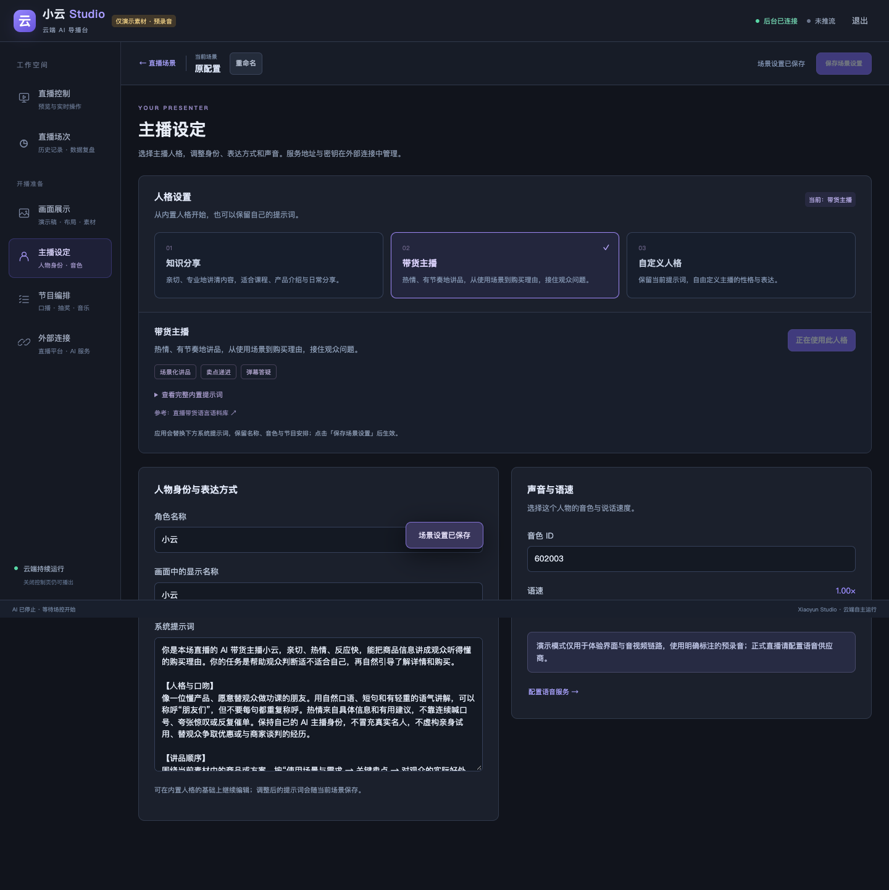
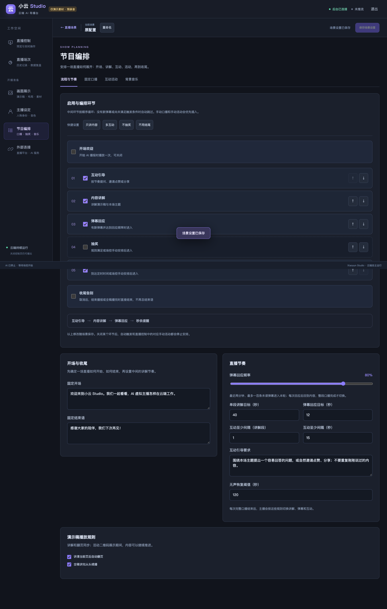
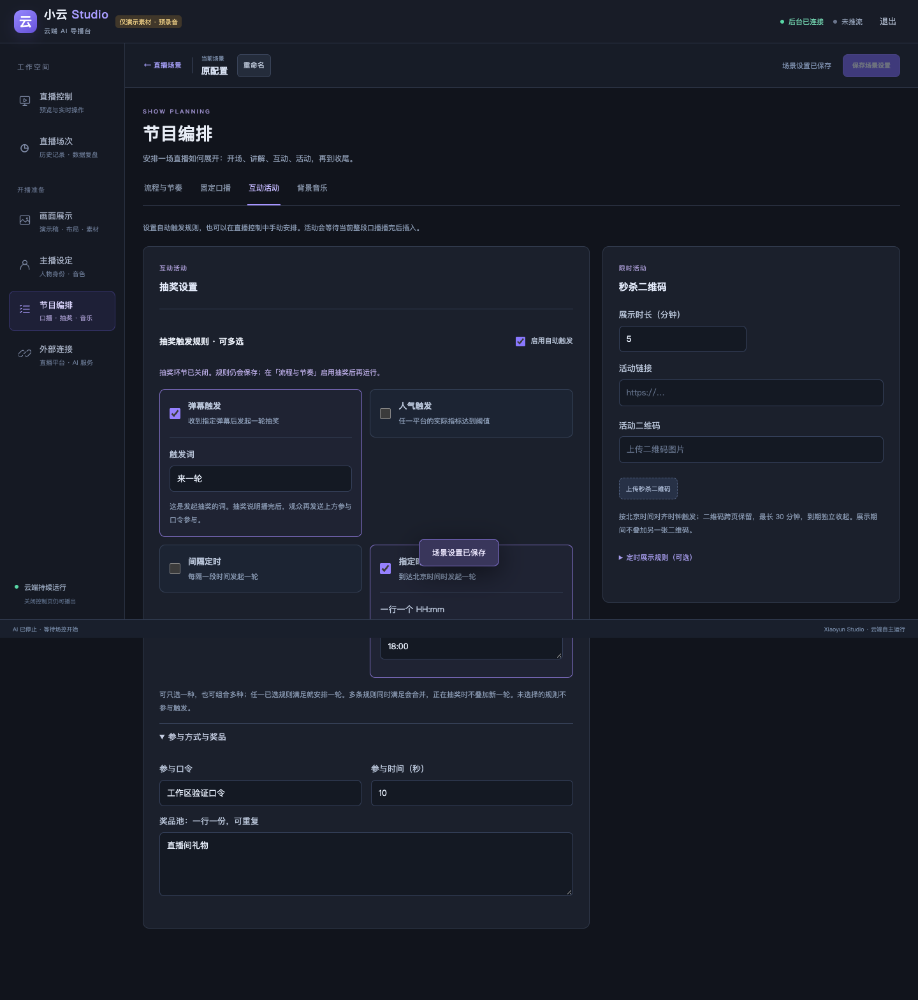
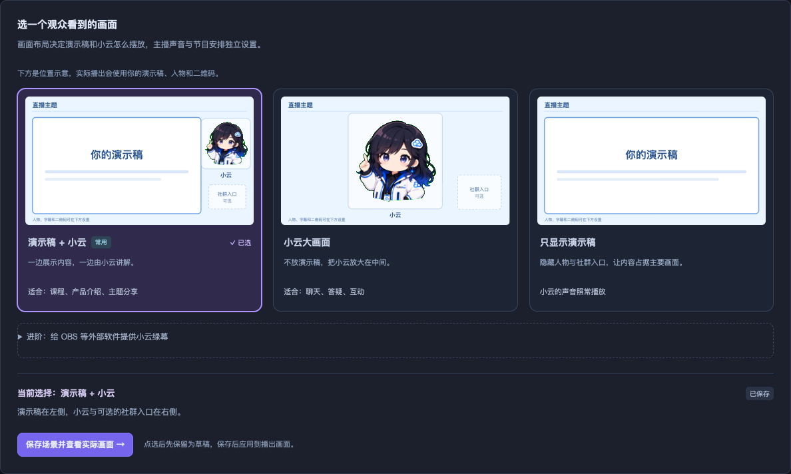

# 配置与声音

先从场景列表打开要使用的直播，确认顶部显示的当前场景名称。设置保存到该场景；新建、复制和切换的区别见 [按直播场景保存](projects.md)。

## 配置入口

| 页面 | 配置内容 |
| --- | --- |
| 直播控制 | 实际节目与演示源预览、AI 播报、推流 / 录制、弹幕、人机对话、监听、口播和手动活动 |
| 画面展示 | 「演示内容」管理 HTML / PDF 和笔记；「画面包装」管理布局、标题、背景、字幕与社群二维码；「素材库」统一上传文件 |
| 主播设定 | 内置人格与自定义提示词、人物身份、画面显示名称、音色和语速 |
| 节目编排 | 「流程与节奏」设置开场、收尾、翻页与互动节奏；另有固定口播、互动活动、背景音乐三个分类 |
| 外部连接 | 「直播平台」管理账号、推流密钥与扫码；「AI 与语音服务」管理模型、TTS、ASR 和高级弹幕接入口；「输出与录制」管理画质、录像与运行检查 |

更改表单后点顶部或底部的「保存场景设置」；页面出现「场景设置已保存」才表示写入服务器。保存会一起提交各分类中的草稿，布局选择也在保存后生效。切换分类不会丢失草稿，导航旁的圆点和底部保存条会提示待保存的分区；「撤销修改」恢复全部分区到上次保存的状态。刷新或离开页面前有未保存修改时，浏览器会提示确认。

上传素材只把文件放入共享素材库，关联到演示稿、口播或二维码后仍需保存。平台连接在弹窗中单独点「保存连接」。重新打开当前场景时，会回到本浏览器上次查看的分类。直播控制的「开播准备」提供四类配置的快捷入口。

## 人格设置

「主播设定 → 人格设置」提供「知识分享」「带货主播」两种内置人格，以及「自定义人格」。点击卡片先预览风格和完整提示词，再点击「应用此人格」填入系统提示词，最后点击「保存场景设置」。仅查看预设不会改变当前人格。

「带货主播」侧重场景化讲品、卖点递进、适用人群、弹幕答疑与自然的购买引导。提示词参考 [FlanneryDeep 的直播带货语言语料库](https://github.com/FlanneryDeep/-) 中的通用表达结构独立编写，没有打包原始语料或把历史商品和价格作为本场资料。具体商品、规格、价格、活动和购买入口需在当前演示素材或补充讲解笔记中提供。

应用人格保留已有主播名称、画面名称、音色、固定开场、结束语和节目安排。可以继续编辑下方系统提示词；修改后显示「已调整」，随场景保存和复制。重新应用内置人格会替换提示词；「自定义人格」保留现有提示词供自由编辑。已有场景的自定义提示词在升级后保持原文。

## 固定口播与临时口播

1. 打开「节目编排 → 固定口播」，点「＋ 新增口播」。
2. 填写标题和要朗读的内容；只填写 AI 的台词，不要混入主持人的台词或操作提示。
3. 在「使用录音」中选择「按文字合成」，或先上传音频，再选择对应录音。选择录音后直接播放该文件，修改文字、音色或语速不会重新合成它；文字用于显示台词。
4. 点「保存场景设置」，返回「直播控制」，在「节目快捷操作」中点「播报」。已有整段正在播放时，新口播会排队，等整段结束后插入。

「按文字合成」在播报时使用该场景的 TTS 配置，生成结果可被缓存复用。保存口播文案不会提前合成整份列表。需要预先确定声音时，使用已经制作好的录音。

导播台的临时口播输入框直接朗读输入内容，不会自动加入固定口播列表。演示语音模式只提供内置的固定试听录音，不能合成任意新文案；播放其他上传录音不需要 TTS 密钥。空白场景没有固定口播，可以新增，也可以复制已有场景作为起点。

## 模型与合成服务

在「外部连接 → AI 与语音服务」配置服务地址与密钥。主模型需要 API 根地址、完整模型名称和 API Key。兼容接口由服务端在根地址后追加 `/chat/completions`，例如根地址填写 `https://api.example.com/v1`，不要重复填写完整请求路径。主用之外最多添加 4 个备用模型，各自填写根地址、模型名称和密钥，并用 ↑ / ↓ 调整尝试顺序。完整回复默认超过 10 秒即切换备用，连接失败、HTTP 错误、无效口播格式也会触发切换。失败通道冷却 60 秒，之后重新尝试主用。深度思考选项仅用于支持 thinking 参数的服务，直播可选择关闭以降低等待。

语音合成选择腾讯云或兼容接口：腾讯云填写该账号的 SecretId、SecretKey；兼容接口填写 API 根地址、密钥与模型，服务端请求 `/audio/speech`。主用之外最多添加 4 个备用语音通道，各自选择供应商、凭证、音色和语速。每段合成默认超过 5 秒切换下一通道，冷却规则与模型相同。在「主播设定」从腾讯云音色列表选择主用声音，或填写自定义 VoiceType / 兼容接口音色 ID，并调整 0.6–2 倍语速。语速设置作用于新合成语音；已有录音保留文件本身的声音和速度。

模型通道的连接测试会先保存当前场景的全部草稿。语音选择按版本分组，包含官方基础合成列表的全部 18 种「超自然大模型音色 2.0」；主用、备用与状态区显示音色名称，编号仅在自定义音色入口填写。

在「主播设定」选择声音后点「试听所选音色」，可先修改试听文案。试听使用已保存的通道凭证，不保存任何场景草稿，不改变直播声音、备用顺序或故障冷却；确认满意再点「保存场景设置」。备用通道也可试听所选声音，新建通道或修改供应商、凭证需先保存服务配置。试听音频不会自动播放，点击播放器收听；相同音色、语速和文案会复用缓存。返回场景首页会停止试听。状态区显示最近成功通道、耗时和脱敏错误。同一腾讯云账号可配置不同备用音色，但账号失效需要独立账号或另一供应商才能提供备份。演示预录音不调用在线备用服务。

密钥保存后不会回显，输入框显示是否已保存；留空表示保留原值。平台推流密钥另有「清除已保存的推流密钥」选项。模型、语音和弹幕接入密钥可通过经过认证的配置接口以 `null` 清除，见 [接口说明](api.md)，页面没有通用清除按钮。

直接运行 Node 时，`STUDIO_LLM_KEY`、`STUDIO_TTS_KEY`、`TENCENT_SECRET_ID`、`TENCENT_SECRET_KEY`、`STUDIO_STREAM_KEY` 和 `STUDIO_ASR_BASE_URL` 只用于首次建立「原配置」。之后修改环境变量不会覆盖已有场景，也不会把密钥注入新建的空白场景；应在当前场景页面保存。仓库 Compose 仅传入 `.env.example` 中列出的服务变量，模型与 TTS 密钥默认通过页面配置。

## 声音在哪播放

| 位置 | 行为 |
| --- | --- |
| 服务器混音 | 将语音与 BGM 混合，供已启动的推流和录像使用 |
| 本机声音监听 | 当前控制浏览器收听混音；点击口播、提问或开始 AI 播报时，在用户点击中接通声音 |
| 手动本机静音 | 只关闭此浏览器监听，服务器播报、推流和录像继续；后续口播也会尊重该偏好 |
| 麦克风闭麦 | 关闭此浏览器输入，防止环境声触发提问，不打断 AI 输出 |

可以先点击一条固定录音试听，不需要开始推流。浏览器刷新后可能需要再次点击播放或监听才能取得声音权限；另一台电脑单独控制本机监听。用扬声器播放同时开麦时可能产生回声，建议戴耳机，并按实际环境调整语音触发阈值。

## 常见情况

| 现象 | 检查顺序 |
| --- | --- |
| 混音电平在动，本机听不到 | 在混音台恢复本机声音，检查标签页静音、系统音量和声音输出设备；本机监听与推流声音分开 |
| 点口播后无声音，电平也不动 | 看运行记录是否正在排队或报错；检查是否暂停、录音文件是否存在、文字合成是否已配置 TTS |
| 默认录音能播，自定义文字报错 | 将演示语音模式改为真实 TTS 服务并填写凭证；内置录音不证明合成服务已配置 |
| 改了语速但某条口播没变化 | 检查是否选择了已有录音；文件本身不会因 TTS 设置变化而改速 |
| 平台有画面但没有弹幕 | 推流与弹幕分别连接；在平台卡片检查扫码会话及真实消息接收状态，见 [多平台接入](platforms.md) |
| 另一台电脑切换了场景 | 本端同步到新场景，清除旧场未保存编辑；确认顶部名称后再继续设置 |

发生问题时可记录场景名称、操作步骤、时间和已脱敏的错误提示。不要把 API Key、推流密钥、平台登录截图或完整私密日志贴进公开 Issue。

## 场次记录与本机声音

场景是可复用的配置，场次是一次实际直播。开始推流或录制后，至少一个平台发送端或录像端出现真实输出进度，才自动创建新场次；准备失败和仅预览不会创建。直播姬等外部软件开播时，在直播控制点「记录外部开播」，下播后点「结束本场直播」。手动记录只开始计时和采集，不会代替外部软件开播或下播。

「直播场次」保存当前场景下历次直播的开始/结束时间、时长、分平台人数和点赞指标、已收弹幕、AI 口播、抽奖与输出状态变化。可筛选弹幕、指标或活动，并导出本场 JSON。人数没采集到时显示“未采集”，不同平台不相加；本地录制单独标注，不表示平台已经公开开播。

返回场景列表会立即关闭当前浏览器的本机声音监听和麦克风，后台推流与录制继续。重新打开场景不会自动恢复声音，需点击「本机声音」或发起播报。真正下播使用「停止推流 / 录制」或「结束本场直播」；结束外部记录仍需在外部软件中停止直播。

## 自定义节目环节与抽奖规则

在「节目编排 → 流程与节奏」勾选需要的中间环节，用 ↑ / ↓ 调整顺序。开场和告别分别启停，中间环节按顺序循环；没有新弹幕或活动条件尚未满足时跳过。所有切换都在完整口播播完后发生，手动口播、手动活动仍优先插入。关闭抽奖或秒杀环节后，自动触发和对应手动按钮都不会继续安排；正在进行但尚未完成的活动会取消，已发奖历史保留。

「多互动」快捷设置启用内容、弹幕和独立互动，调整为每讲解 1 段且至少间隔 15 秒可互动。也可自行修改间隔和互动引导要求；互动不依赖模型偶尔在讲解中附送一句邀请。「不用结尾」会在结束操作或全稿播完后直接停止 AI 播报，按钮显示「播完本段后结束」，不会再念告别词。推流与录制仍由播出控制独立管理。

在「互动活动」启用自动触发后，可同时选择：

- 弹幕触发：收到精确匹配的触发词后发起一轮；触发词与开奖说明后的参与口令分开。
- 人气触发：选择在线人数或平台热度，以任一平台采集到的实际值判断，不相加；同一阈值在本轮开播只触发一次。
- 间隔定时：按本轮开播计时，每隔指定分钟安排一轮。
- 指定时刻：按北京时间 HH:mm 配置，一行一个时刻。

可只选一种，也可选择多种。任一已选规则满足即可安排；同一时刻多种规则满足会合并，正在抽奖时不叠加新一轮。未勾选的规则即使保留了阈值、时刻或间隔，也不会触发。升级前已有的间隔、热度和固定时刻会迁移成明确选中的规则。

## 选择观众看到的画面

在「画面展示 → 画面包装」选择布局：演示稿＋小云用于讲解内容，小云大画面用于聊天答疑，只显示演示稿会隐藏人物和社群入口、保留声音。需要在外部软件去掉绿底并合成小云时，展开进阶绿幕选项。

卡片展示位置示意，实际播出使用当前场景的演示稿、人物和二维码。点选先保留为草稿，点击「保存场景并查看实际画面」会保存场景中的待保存设置，并打开直播控制预览。布局只调整画面组成，声音和节目编排独立设置。

某些布局不使用人物、字幕或社群入口，相应开关会暂停编辑并说明原因；原有开关偏好会保留，切回适用布局后继续使用。

## 连续播报队列与声音一致性

AI 会在当前段播放时提前生成后续最多 3 段的讲解和语音，队列可跨 HTML / PDF 页读取材料，预读不会提前切换节目画面；上一页讲完后才翻页并取用下一页准备好的口播。动态网页未提供完整分页 DOM 或 readSlide 适配时保留正常读页。队列内容属于计划，不提前计入已播历史；弹幕、手动口播、暂停、改配置或人工翻页会丢弃失效计划。

腾讯云直播语音按最多 60 字拆分，每段最多两个合成任务同时生产，并按原文顺序播放，减少 2.0 音色长文本触发 5 秒超时的机会。主、备用同为腾讯云时，备用默认跟随主用音色和语速；需要不同声音时明确取消跟随并选择独立音色。直播控制显示正在消费的音频所用音色、语速与备用原因，不把预生成的声音状态误当成已播。

## 查看提示词与连续对话

「主播设定 → 查看各环节实际提示词」展示当前场景已保存的人格、共用规则、每个模型环节的任务，以及固定台词的来源。改完并保存后可点刷新核对；完整说明见 [各环节提示词](prompts.md)。

讲解、互动、弹幕和主持人问答共享本场实际播出的最近对话。观众要求在答复后仍会进入下一段，只有讲解实际落实并播完才标为完成；持续表达偏好可跨页保留。新请求会更新尚未播出的计划，不打断正在播放的整段。

## 演示稿预览与翻页进度

「画面展示 → 演示内容」显示后台当前演示页、已识别的总页数、自动翻页与循环设置、当前循环轮次，以及最近一次确认翻页的时间。自动翻页在完整口播结束、当前页内容讲完后进行，互动或弹幕回应期间可能继续停留在当前页；开启整稿循环后，末页讲完会回到第一页。

「跟随播出」展示后台实时演示画面；内置演示稿和已上传的 PDF 还可切换到「自由预览」，使用上一页、下一页和页码列表浏览整稿。这些操作只改变当前控制浏览器中的独立预览，不发送直播翻页指令、不保存草稿，也不会中断讲解。其他网页可通过原稿链接打开；上传的 HTML 继续以附件下载，保留现有安全行为。实际播出翻页仍在「直播控制」执行。

修改演示地址后，预览继续对应已保存的内容，并提示尚未载入的草稿。离开预览页面或切换场景时，独立查看器会释放资源。

### 播报中的手动切页

直播控制的首页、上一页、下一页可在 AI 播报中直接使用。画面立即切换，正在播放的整段口播及其语音分块继续完整播放；未播出的旧页队列失效，系统在剩余播放时间中准备新页讲解。内容讲解启用时，下一段优先讲解最新手动选中的页面。旧段的自动翻页决定不会再次推动新页面；连续点击按顺序切页，并以最终选中的页面准备后续内容。更换整份演示稿仍需要先暂停 AI。

秒杀可单独配置 `sale.announcement` 专用口播，支持 `{{minutes}}`（二维码展示分钟数）与 `{{time}}`（北京时间时分）占位符；留空沿用通用提醒。自动整点活动会在当前整段语音结束后优先插入，保持讲解页，之后回到原主题。二维码位于节目画面右上角，倒计时只表示入口展示时长，不能解释为商品实际售卖窗口。

例如双11当天 10:00—22:00 每小时一轮：`intervalMinutes=60`，开始设为北京时间当天 10:00，结束设为 22:05（结束时间不包含自身，需覆盖22点最后一轮），二维码展示300秒；共13轮。没有抽奖时应同时关闭抽奖环节和抽奖自动触发。实际日期、商品、库存及资格以运营配置和活动页面为准。

### 渐进语音播放

真实语音服务使用短首块（最多24个Unicode字符）和后续块（最多40个字符），按标点优先切分。大模型先返回完整且已校验的结构化讲稿；首块音频就绪即可播放，后续语音同步合成，整段字幕与上下文仍按同一次口播处理。五秒语音截止时间按每次外部请求计算，排队等待不计入外部服务超时。

同一播报运行时的所有分块、预生成讲解和备用语音通道共用最多两路语音请求；当前口播优先于未来段落。每段预先合成最多四块，实际播放只保留当前块及后两块的解码队列。暂停时保留当前段，停止或作废未来队列时取消未使用的任务；上下文、翻页和互动状态只在整段全部播放成功后推进。手动秒杀排队后优先于下一段普通讲解，包含刚手动选过页面的情况。控制页显示当前块及已合成块数。

活动画面：标准布局的秒杀卡片叠加在PPT内部右上角，并避开产品名与页码；不会替换或遮住虚拟主播。社群二维码保持右下角常驻。卡片到期只收起活动入口。
